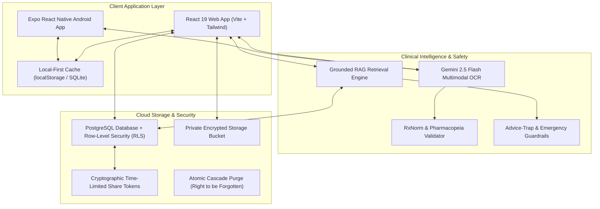

# CareVault — Personal Health Records Vault & Clinical AI Assistant

[](https://dtm1n.github.io/carevault-mobile-android-source/)
[](https://react.dev/)
[](https://www.typescriptlang.org/)
[](https://vitejs.dev/)
[](https://tailwindcss.com/)
[](https://deepmind.google/technologies/gemini/)
[](https://expo.dev/)

> **CareVault** is a production-grade, privacy-first personal health record organizer and grounded clinical assistant. Built with a local-first web architecture (React 19 + TypeScript) and an Android companion app (React Native / Expo), CareVault enables patients and caregivers to ingest, index, and query lifelong medical records while enforcing strict clinical safety guardrails.

---

## ⚡ Quick Links & Live Demonstration

- 🌐 **Live Web Application:** [Deployable on GitHub Pages, Vercel, or Netlify](./dist/)
- 📄 **Architecture & Specifications:** Open via the in-app **"Architecture & Specs"** button or header showcase.
- 📱 **Mobile Companion App:** React Native (Expo SDK 58) in [`mobile/`](mobile/) with document camera scanner and biometric lock.

---

## 🩺 Key Features & Capabilities

### 1. Multimodal Document Ingestion & OCR
- **Fast Multimodal Processing:** Ingests prescriptions, lab reports, discharge summaries, imaging notes, and bills (PDF, JPG, PNG, WebP up to 15 MB).
- **Multi-Stage Prescription Parsing:** Extracts medicine names, strengths, dosages, frequency, and instructions, cross-checking against the **RxNorm** database and WHO Essential Medicines catalogue with verification badges.
- **Editable Clinical Review:** Zero-hallucination workflow — every extracted field is presented to the user with confidence scores for human verification before saving.
- **1-Click Sample Ingestion:** Built-in interactive sample presets (Prescriptions, Metabolic Panels, Discharge Notes) for instant demonstration without uploading personal files.

### 2. Source-Grounded Clinical AI Assistant ("Ask My Records")
- **Zero-Hallucination Retrieval:** Answers user questions strictly using facts present in verified records, providing clickable citations to source documents.
- **Clinical Advice Trap Guardrails:** Intelligently intercepts questions soliciting clinical diagnoses, prognoses, or dosage changes (e.g., *"Can I stop my blood pressure medicine?"* or *"Do I have diabetes?"*), redirecting patients safely to their physician.
- **Emergency Situations Barrier:** Automatically detects acute emergencies (e.g., chest pain, shortness of breath, signs of stroke) and displays prominent emergency guidance directing the user to 911 / 112 services.

### 3. Longitudinal Lab Trend Visualizer
- **Interactive SVG Chronological Charts:** Charts numeric test observations (HbA1c, Fasting Glucose, TSH, Total Cholesterol, Creatinine) over time.
- **Reference Range Markers:** Displays published reference intervals and flags borderline or elevated results as printed on the original report.
- **Filter by Specific Test:** Instant isolation of individual lab parameters across multi-year checkups.

### 4. Doctor Preparation Pack & Clinical Summary
- **Printable Consultation Sheet:** One-page clinical summary compiling active medications, allergies, chronic conditions, and recent lab history.
- **Doctor Questions Builder:** Space for patients to record symptoms and specific questions prior to clinical consultations.
- **Print-Optimized Layout:** Formatted with clean CSS `@media print` rules for physical printing or export to PDF.

### 5. Critical Emergency Medical ID Card
- **Quick-Access Medical ID:** Blood group badge, confirmed food/drug allergies, chronic illnesses, and emergency contact numbers.
- **Printable Wallet Card:** Printable mini-card for wallet or phone case storage.

### 6. Time-Limited Revocable Doctor Sharing & QR Codes
- **Phone-Free Doctor Sharing:** Generates temporary cryptographic URLs and dynamic QR codes with configurable expiration (1, 7, or 30 days).
- **One-Click Revocation:** Patients can instantly invalidate active share links at any time.
- **Read-Only Clinician Portal:** Clean, distraction-free doctor review interface with zero access to unrelated family records.

### 7. Accessibility & Senior-Friendly Design
- **High-Contrast Dark Mode:** Reduces eye strain during nighttime review.
- **Large Text Scaling:** Boosts typography and button tap targets across all views.
- **Simplified Senior Mode:** Conceals advanced filters and technical badges, focusing on large essential action cards.
- **Multi-Lingual Speech Synthesis:** Audio read-out of record summaries in **English**, **Hindi (हिन्दी)**, and **Urdu (اردو)**.

---

## 🏗️ System Architecture



---

## 📄 Resume-Ready Project Description

Copy and paste these bullet points directly into your Software Engineer / Full-Stack / Frontend / Mobile resume:

```text
CareVault — Personal Health Records Vault & Clinical AI Assistant
• Engineered CareVault, a HIPAA-aware, local-first personal health record organizer with multi-page OCR document ingestion, structured medication extraction, and interactive longitudinal lab trend charts.
• Implemented a grounded AI RAG assistant powered by Gemini 2.5 Flash, featuring strict clinical safety guardrails, advice-trap query redirection, and automatic routing of emergency symptoms to emergency services (911/112).
• Designed a secure, privacy-first data architecture using PostgreSQL Row-Level Security (RLS), SHA-256 content deduplication, revocable time-limited clinician share links with dynamic QR codes, and 100% complete data erasure.
• Built a unified multi-platform ecosystem with a responsive React 19 / TypeScript web app (WCAG high-contrast, speech synthesis, senior-friendly mode) and an Android-first React Native / Expo counterpart with document camera scanner and biometric authentication.
```

---

## 🚀 Getting Started

### Prerequisites
- Node.js 20+ or 22+
- npm 10+

### Run the Web Application Locally

```bash
# Clone the repository
git clone https://github.com/dtm1n/carevault-mobile-android-source.git
cd carevault-mobile-android-source

# Install dependencies
npm install

# Start the Vite development server
npm run dev
```

Visit `http://localhost:3000` to interact with the full application in local demo mode.

### Production Build

```bash
# Run type check, linter, and server tests
npm run type-check
npm run lint
npm test

# Build production assets for deployment
npm run build
```

The compiled, standalone static bundle will be generated in `dist/`.

---

## 📱 Mobile Companion App (Android / Expo)

The native mobile app is located in [`mobile/`](mobile/).

```bash
cd mobile
npm install
npx expo start
```

### Mobile Features:
- Native hardware document camera with edge detection and perspective alignment.
- Local biometric authentication (Fingerprint / Face Unlock).
- Offline SQLite cache with automatic background sync queue.

---

## 🔒 Security & Medical Disclaimers

1. **Non-Diagnostic Tool:** CareVault is an administrative records organizer, not a clinical diagnostic system or medical provider. It does not provide medical evaluations, prescriptions, or clinical treatments.
2. **Zero-Trust Privacy:** Records in private mode remain strictly on the client or in tenant-isolated PostgreSQL tables protected by Row-Level Security.
3. **Right to be Forgotten:** Users can permanently delete all accounts, profiles, and health records in a single atomic transaction by typing `DELETE`.

---

## 📜 License

This project is licensed under the MIT License — see the [LICENSE](LICENSE) file for details.
