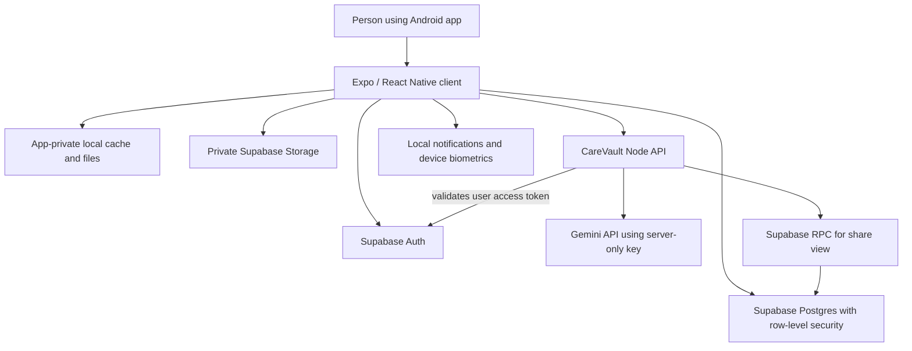

# CareVault architecture

## Trust boundaries

- Expo `EXPO_PUBLIC_*` values are delivered to the client. Only Supabase URL and a publishable/anon key belong there; no service-role or AI secret belongs there.
- Supabase row-level security and private Storage policies are the server-side data boundary. Client UI filters are not access controls.
- AI extraction receives only the selected file after a consent prompt and a signed-in session. It returns an editable draft; never treat extraction as verified facts.
- Share URLs are bearer credentials. Use HTTPS, short expiry, revocation and minimal fields. Anyone with the link can see its permitted fields until expiration/revocation.
- The local cache is app-private, but the current build is **not end-to-end encrypted** with a user-held key.
