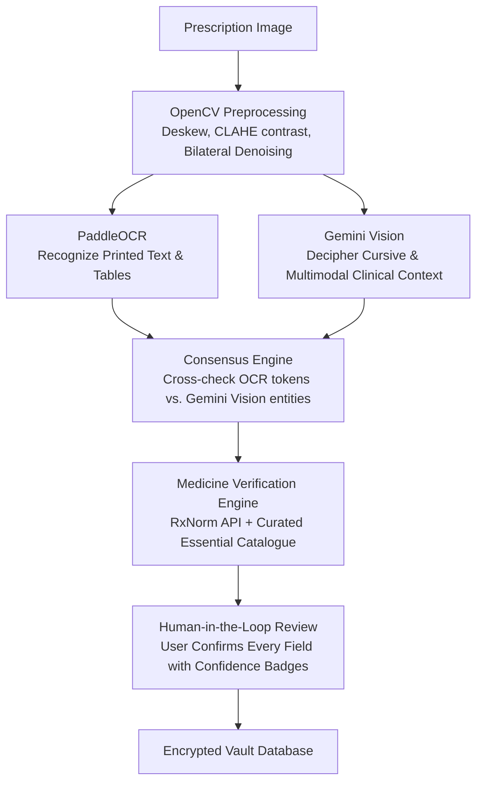

# CareVault Prescription Helper — Multi-Stage OCR + Verification Pipeline

This microservice implements the multi-stage prescription extraction and verification architecture designed to achieve high accuracy on clinical documents, printed headers, and doctor handwriting.

## Pipeline Architecture



## Features

1. **OpenCV Preprocessing (`preprocess.py`)**:
   - Skew calculation & auto-rotation via Hough lines / minAreaRect contours.
   - Contrast Limited Adaptive Histogram Equalization (CLAHE) on the L-channel to eliminate shadows and flash glare.
   - Bilateral filtering to smooth paper grain while keeping character edges crisp.

2. **PaddleOCR Engine (`ocr_engine.py`)**:
   - High-precision text line and token extraction with bounding boxes and per-character confidence scores.

3. **Consensus & Hallucination Elimination (`consensus.py`)**:
   - Reconciles Gemini multimodal predictions against OCR token streams.
   - Detects and flags any medicine names guessed by AI that have no grounding on the page.

4. **Pharmacopeial Verification (`server/medicineVerification.mjs`)**:
   - NIH RxNorm REST API integration (RxCUI concept normalization).
   - Embedded offline catalogue of 200+ top international and Indian essential drugs.
   - Standard strength sanity checks (e.g., flags 6250mg instead of 625mg).

5. **Evaluation Benchmark Suite (`evaluate.py`)**:
   - Benchmark runner against 100–200 ground-truth annotated prescription images.
   - Strict target gates:
     - Medicine-name exact match: ≥ 95%
     - Strength exact match: ≥ 95%
     - Dosage exact match: ≥ 95%
     - Frequency exact match: ≥ 95%
     - Unsupported medicine guesses: 0
     - Incorrect fields silently saved: 0

## Quickstart

### 1. Install Dependencies

```bash
cd services/prescription-pipeline
python3 -m venv venv
source venv/bin/activate
pip install -r requirements.txt
```

### 2. Run Tests

```bash
python3 test_pipeline.py
```

### 3. Start the FastAPI Service

```bash
uvicorn main:app --reload --port 8000
```

### 4. Run Benchmark Evaluation

```bash
python3 -c "
import json
from evaluate import evaluate_extractions

with open('sample_evaluation_dataset.json') as f:
    gt = json.load(f)

# Evaluate sample predictions
predictions = [{'id': s['id'], 'extracted_medicines': s['expected_medicines']} for s in gt]
report = evaluate_extractions(predictions, gt)
print(report['markdown_summary'])
"
```
